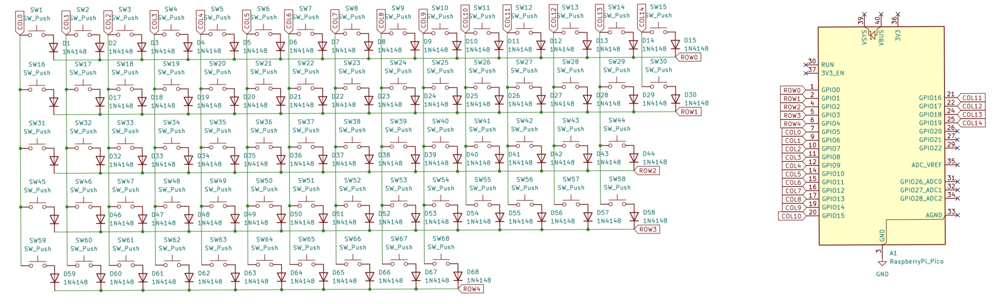
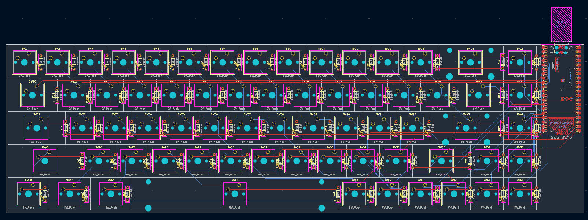
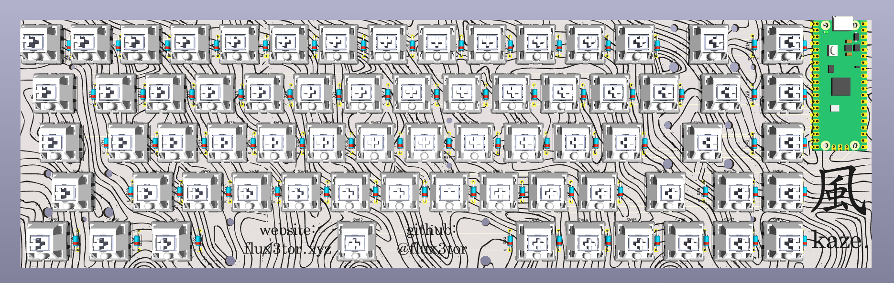
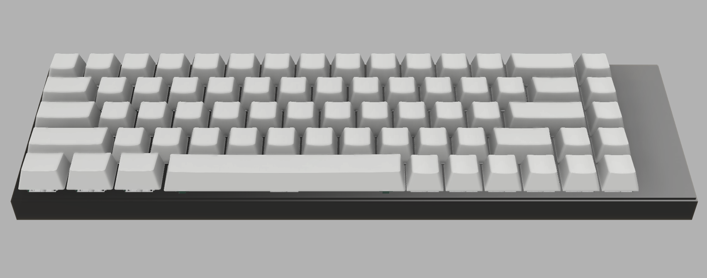

# kaze.

kaze is a custom 65%-style mechanical keyboard powered by the Raspberry Pi Pico (RP2040). It features a custom-designed PCB, a compact 3D-printed case, and RMK firmware.

---

## Why did I make it?

I wanted to build my own keyboard instead of buying one off the shelf. kaze is my take on a compact, silent mechanical keyboard, designed around the layout and features I actually want.

---

## Project Images

### Schematic

### PCB

### PCB Render

### Case Render

---

Features:
- 68-key custom layout
- Raspberry Pi Pico (RP2040) controller
- Custom KiCad PCB and schematic
- Individual diodes for the switch matrix
- Custom case design
- RMK firmware written in Rust
- Base layer and Fn layer
- Dedicated arrow keys
- Brightness and volume controls in the keymap

---

## Firmware

Kaze. uses [RMK](https://github.com/HaoboGu/rmk), a Rust-based keyboard firmware.

The firmware configuration is in [`Firmware/keyboard.toml`](Firmware/keyboard.toml), and the configurator definition is in [`Firmware/vial.json`](Firmware/vial.json).

---

## BOM

| Name | Purpose | Quantity | Unit Cost (USD) | Total Cost (USD) | Distributor |
|---|---|---:|---:|---:|---|
| [Akko V3 Fairy Pro Switches (Pack of 45)](https://stackskb.com/store/akko-fairy-pro-switch-pack-of-45/) | Mechanical switches | 2 | $16.00 | $32.00 | StacksKB |
| [Lakes Mountains Premium Cherry PBT Extended Keycaps](https://curiositycaps.in/products/lakes-mountains-premium-cherry-pbt-extended-keycaps) | Keycaps | 1 | $29.00 | $29.00 | Curiosity Caps |
| [Durock Clear Screw-In Stabilizers V2](https://stackskb.com/store/durock-clear-screw-in-stabilizers-v2/?attribute_combination=4%2B1+Set&attribute_spacebar-size=6.25U) | Stabilizers | 1 | $17.00 | $17.00 | StacksKB |
| [1N4148 Through-Hole Diodes (Pack of 10)](https://stackskb.com/store/1n4148-through-hole-diode/) | Matrix diodes | 7 | $0.20 | $2 | StacksKB |
| [LuatOS USB-C Raspberry Pi Pico Development Board](https://makerbazar.in/products/luatos-usb-c-raspberry-pi-pico-development-board-based-on-rp2040-microcontroller) | Main controller | 1 | $5.00 | $5.00 | MakerBazar |
| [Portronics Type-C to Type-C Cable](https://www.amazon.in/dp/B09Q8XMFHB?ref_=cm_sw_r_cp_ud_dp_9F8YCTNXZB2SQ3WDDXEK_1) | USB connection | 1 | $2.00 | $2.00 | Amazon |
| [PLA Filament](https://india.numakers.com/products/pla-filament) | 3D-printed case | 1 | Already owned | $0.00 | Numakers |
| PCB | Keyboard circuit board | 5 | 25 | 25 | Offline/Local Fabricator |

## Total Pricing
The total price comes out to be **₹10,600 ($112), including shipping, and taxes.**

---

## Project Files

- `CAD/` - case and assembly CAD files
- `Firmware/` - firmware configuration and UF2 file
- `Images/` - project renders and schematic/PCB images
- `PCB/` - KiCad schematic, PCB, and production files

---

Made with <3 by [Flux3tor](https://github.com/Flux3tor)